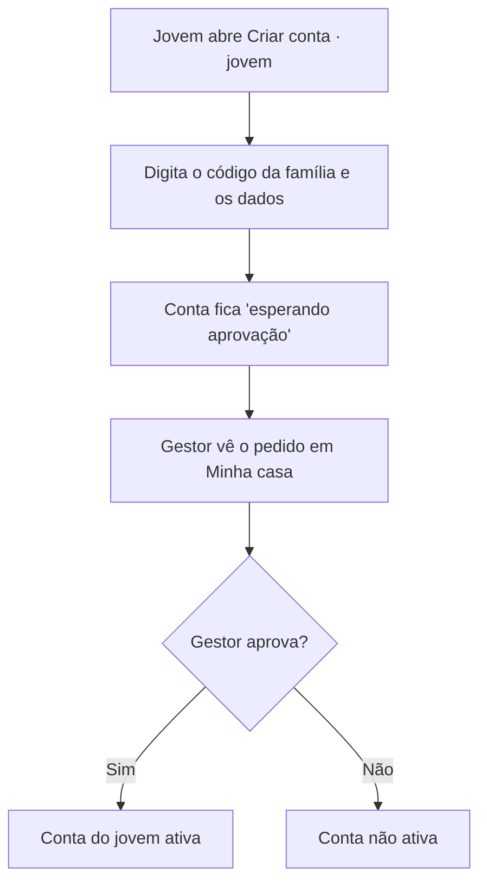

# Fluxos principais

Fonte: requisitos da V1, seção "Fluxos principais"; Desapego e Eventos, seções "Como funciona".

## Cadastro e aprovação do jovem

O documento original traz um diagrama embutido ("cadastro e aprovação do jovem · 4 passos, 1 decisão") que não veio no arquivo exportado. O texto dos requisitos diz:

> O código da família liga cada pessoa à casa certa, e o gestor aprova toda conta de jovem antes de ela funcionar.

Reconstrução fiel ao texto (sem inventar passos além dos citados nas telas Criar conta · jovem, Minha casa e nos critérios de aceite):

O que acontece quando o gestor recusa não está descrito nos requisitos.

**Adultos da casa** seguem o mesmo caminho com o código, mas a conta **ativa na hora** e o gestor recebe um aviso.

## Entrar

1. A pessoa escolhe a aba **Gestor da casa** ou **Morador jovem**.
2. Digita e-mail ou celular; o app mostra se a conta existe, se é de outro perfil ou se espera aprovação.
3. Sem cadastro, o app oferece criar conta **pelo app ou pelo WhatsApp**.
4. Com a senha certa, entra no início do seu perfil.

## Publicar um aviso (organizador)

1. Escolhe o tipo **Aviso** e para quem: todos, só gestores ou só jovens.
2. Escolhe o nível e a categoria e preenche **o quê, quando, onde e o que fazer**.
3. Confere a prévia e os canais obrigatórios do nível (**sempre com SMS**).
4. Publica na hora ou agenda; o aviso aparece no app e sai por SMS.
5. Acompanha o alcance e **reenvia para quem ainda não viu**.

## Anunciar no Desapego

1. Tira uma foto do objeto.
2. Escolhe a categoria, escreve descrição curta e coloca o preço (ou marca como doação).
3. O anúncio aparece para todos os moradores (sem aprovação).
4. Quem se interessa chama pela conversa do app.
5. Combinam a entrega, e o vendedor marca como vendido.

## Evento (V1)

1. Organizador cria o evento (nome, data e hora, local, interesse, ingresso solidário, vagas).
2. Evento de grupo fica **esperando aprovação**; a Administração aprova (publica na agenda) ou recusa (avisa quem enviou).
3. Aparece na agenda; morador toca **Eu vou**.
4. Lembrete no dia.

O pós-evento (fotos e resultado) é Fase 2.
